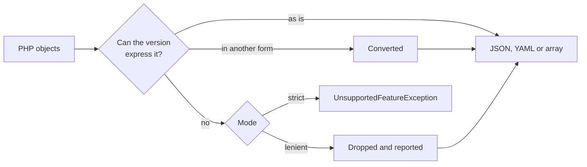

You describe the API once, with the model of the latest version, and choose the OpenAPI version when writing. The same
`OpenApi` object can be written for 3.0.4, 3.1.2 and 3.2.0 in a row.

## Supported versions

| Version | When to choose it |
| --- | --- |
| 3.1.2 (default), 3.1.1, 3.1.0 | Most tools; full JSON Schema 2020-12 |
| 3.0.4, 3.0.3, 3.0.2, 3.0.1, 3.0.0 | Older tools: some code generators, older Swagger UI versions |
| 3.2.0 | Its new features, when every consumer reads 3.2; see [OpenAPI 3.2](/openapi-writer/versions-and-output/openapi-3-2) |

Within a line (3.0.x, 3.1.x), the output is the same except for the `openapi` field.

## Where the version comes from

The first of these that is set wins:

1. the version passed to the method: `toJson(Version::V3_0_4)`, `Serializer::for('3.0.4')`,
   `$validator->validate($document, '3.0.4')`;
2. the version declared by the document: `OpenApi::create()->openapi(Version::V3_2_0)`;
3. 3.1.2.

```php
use Ark4ne\OpenApiWriter\Enums\Version;

$document = $document->openapi(Version::V3_2_0);

$document->toJson();                  // 3.2.0, as declared
$document->toJson(Version::V3_0_4);   // 3.0.4
$document->toJson('3.1.2');           // a version string works too
```

## What happens when writing



Each field and each difference between versions falls in one of three cases:

- **Written as is**: the field exists in the version.
- **Converted**: the version expresses it in another form. A nullable string becomes `nullable: true` in 3.0,
  `const` becomes a one-value `enum`. See [Conversions](/openapi-writer/versions-and-output/conversions).
- **Unsupported**: the version has no way to express it, such as webhooks in 3.0. In strict mode, the default, the
  library throws one exception listing all of them; in lenient mode it drops them and reports each one. See
  [Strict and lenient](/openapi-writer/versions-and-output/strict-and-lenient).

## Targeting several versions

To publish one document for several versions:

- use only the features of the oldest version, and write each version in strict mode: any slip throws;
- or declare the newest version, and write the older ones in lenient mode, checking what was dropped:

```php
use Ark4ne\OpenApiWriter\Enums\Strictness;
use Ark4ne\OpenApiWriter\Serialization\DiagnosticLevel;
use Ark4ne\OpenApiWriter\Serialization\Serializer;

$v32 = $document->openapi(Version::V3_2_0)->toJson();

$result = Serializer::for(Version::V3_0_4, Strictness::Lenient)
    ->serialize($document);
$v30 = $result->toJson();
$lost = $result->diagnostics()->ofLevel(DiagnosticLevel::Dropped);
```

Validate each version you publish: see [Validating a document](/openapi-writer/validation/validating-a-document).
